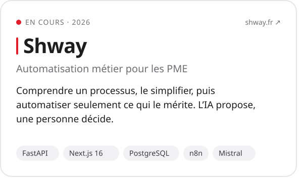
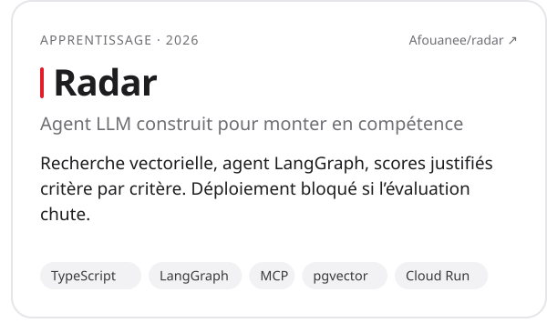
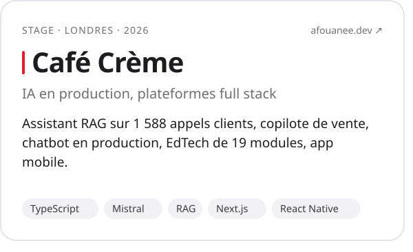
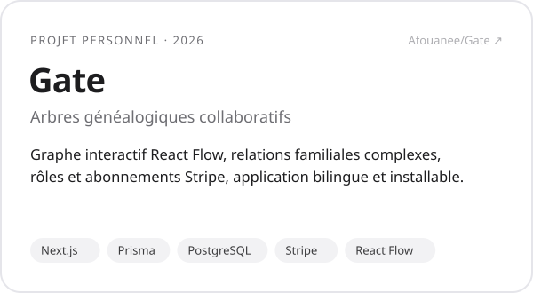
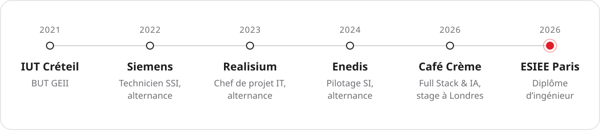
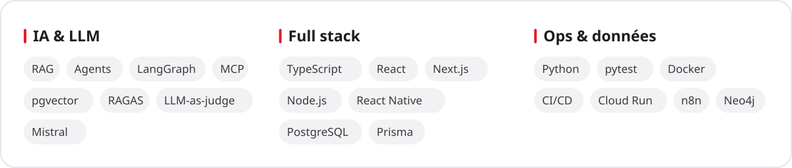
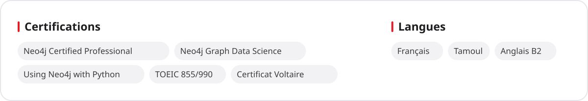

<picture>
  <source media="(prefers-color-scheme: dark)" srcset="assets/header-dark.svg">
  
</picture>

  <a href="https://afouanee.dev"><b>Portfolio</b></a>
  &nbsp;·&nbsp;
  <a href="https://www.linkedin.com/in/afouane-mouhamad"><b>LinkedIn</b></a>
  &nbsp;·&nbsp;
  <a href="https://afouanee.dev/#contact"><b>Me contacter</b></a>

Je construis des produits qui mettent l'IA au travail, pas des démos. Je les conçois, je les déploie, puis je mesure s'ils servent vraiment. Diplômé ingénieur de l'ESIEE Paris en 2026, après un parcours en alternance et un stage à Londres.

- **Je cherche** un poste d'ingénieur Full Stack & IA, en France ou à l'international.
- **Je lance [Shway](https://shway.fr)** : j'aide les PME à simplifier un processus qui leur fait perdre du temps, puis à automatiser ce qui le mérite.

## Projets

<a href="https://shway.fr"><picture><source media="(prefers-color-scheme: dark)" srcset="assets/card-shway-dark.svg"></picture></a><a href="https://github.com/Afouanee/radar"><picture><source media="(prefers-color-scheme: dark)" srcset="assets/card-radar-dark.svg"></picture></a><a href="https://afouanee.dev/projects/internal-rag-sales-assistant"><picture><source media="(prefers-color-scheme: dark)" srcset="assets/card-cafe-creme-dark.svg"></picture></a><a href="https://github.com/Afouanee/Gate"><picture><source media="(prefers-color-scheme: dark)" srcset="assets/card-gate-dark.svg"></picture></a>

Mais aussi **[Nooza](https://nooza.app)**, un SaaS pour les artisans qui vendent sur Instagram, conçu et mis en ligne seul (arrêté en octobre 2026), et **[Milo](https://afouanee.dev/projects/milo-ai-literacy-kids)**, une école de l'IA pour les 6-16 ans. Tous mes projets sont sur **[afouanee.dev](https://afouanee.dev/#projects)**.

## Parcours

<picture>
  <source media="(prefers-color-scheme: dark)" srcset="assets/timeline-dark.svg">
  
</picture>

## Stack

<picture>
  <source media="(prefers-color-scheme: dark)" srcset="assets/stack-dark.svg">
  
</picture>

## Activité

<picture>
  <source media="(prefers-color-scheme: dark)" srcset="assets/contributions-dark.svg">
  
</picture>

## Certifications et langues

<picture>
  <source media="(prefers-color-scheme: dark)" srcset="assets/certifications-dark.svg">
  
</picture>
